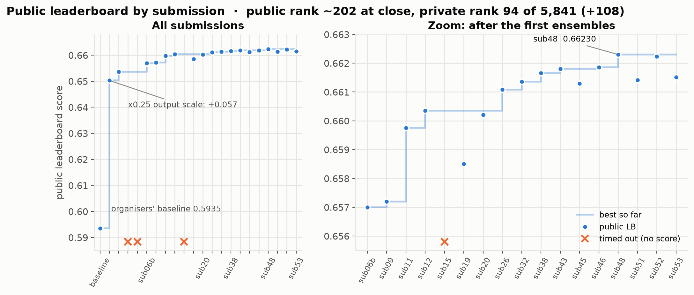
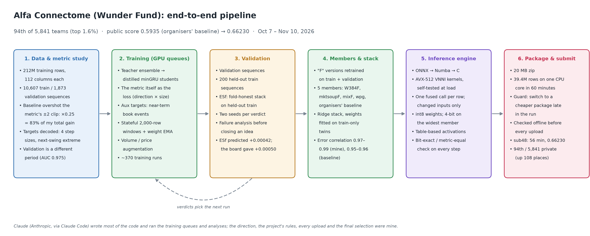

# Alfa Connectome (Wunder Fund): 94th of 5,841

**Final result: 94th of 5,841 teams on the private leaderboard (top 1.6%).** My best public score was 0.66230, up from 0.5935 for the organisers' baseline. My best public rank was about 160. After I stopped submitting, other teams passed me and I sat at about 202 on the public board when it closed. On the private leaderboard I finished 94th: **up 108 places**.

## The problem
- **The data:** two anonymised order-book instruments, streamed one row at a time: 112 features per row, 20,000-row sequences.
- **The task:** predict two indicators of the first instrument's next price move.
- **The metric:** a weighted Pearson correlation pooled over a hidden subset of rows.
- **The catch:** inference had to process **39.4 million rows on one CPU core in 60 minutes**, from a zip of at most 20 MB. That's about 90 µs per row for everything.

## What I built
- A linear stack of five streaming recurrent models:
  - three minGRU models (up to 384 wide, 4 layers deep);
  - a fourth minGRU trained with a different loss;
  - the organisers' own baseline GRU.
- All five run in a hand-written C inference engine with int8 and 4-bit weights.
- The final package ran the 39.4M rows in 56 minutes.

## What mattered most
1. **Reading the metric before building models.** On day one, my analysis of the baseline showed that a large share of its predictions sat beyond the metric's ±2 clip. Rescaling the outputs by 0.25, with no retraining, gave +0.057, which is 83% of my total gain.
2. **Understanding the data.**
   - The targets fall into four step-size groups, and the coarsest group carries 48% of the score weight but is predicted far worse (0.44 vs 0.73–0.80).
   - The targets measure the end of the next price swing.
   - The missing information sits in the next ~100 rows, which no causal model can see.
3. **Validation I could trust.** Validation ran 0.023–0.031 above the leaderboard, and gains of +0.003 often vanished. I built several yardsticks and a two-seed rule. The final one, a fold-honest stack scored on held-out train sequences, predicted my best submission's gain over an earlier line-up (sub43) at +0.00042; the board measured +0.00050.
4. **Error diversity over model count.** My members' errors correlate 0.97–0.99 with each other. The organisers' baseline, the weakest member (0.673 alone on validation), correlates 0.95–0.96, the most different of the five, so it stayed in the stack. Dropping it cost 0.0015–0.0020 on the held-out-train stack check.
5. **Inference engineering.**
   - Several of my best ensembles timed out at first.
   - Going from ONNX Runtime to Numba to a C engine with AVX-512 VNNI int8 kernels and 4-bit weights is what let the final line-up run at all.

## Tools and roles
Claude (Anthropic's model, through Claude Code) wrote the code.

I set the direction and the rules, for example:
- no tuning toward the hidden scoring mask;
- two seeds before any verdict;
- nothing ships without verification against the offline pipeline.

I chose what to test and what to analyse, ran the experiments and made every submission and final-selection decision.

## Read more
- [Summary](summary.md) (3–4 pages): the problem, the score sources, data findings, the model, validation, the engine, failures and lessons.
- [Complete write-up](technical.md): everything, including a quantified failure analysis and appendices with all ~70 submissions, a dated timeline and a catalogue of about 280 experiments.
- [Figures](figures/), built from my saved results and notes.
- [My three final submissions](submissions/) (inference code and my models' weights).
