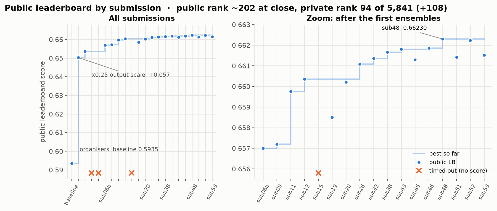
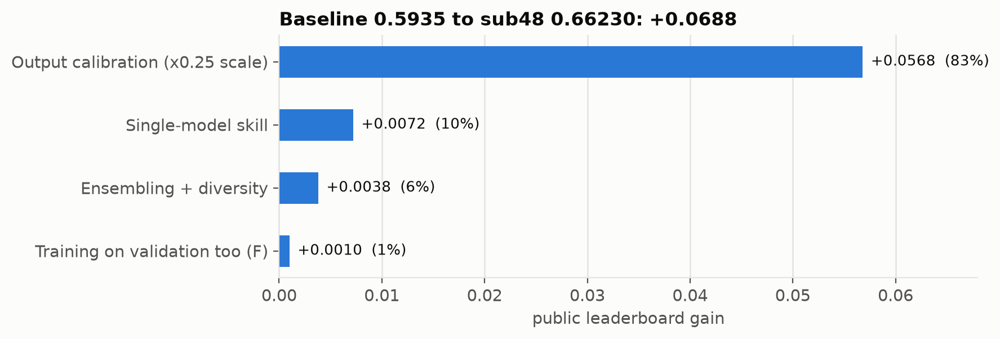
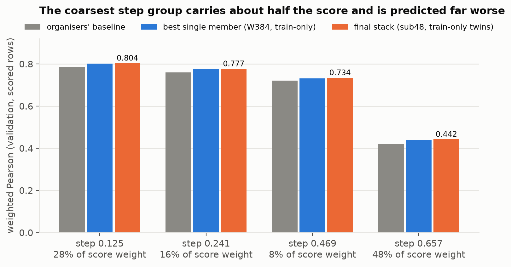
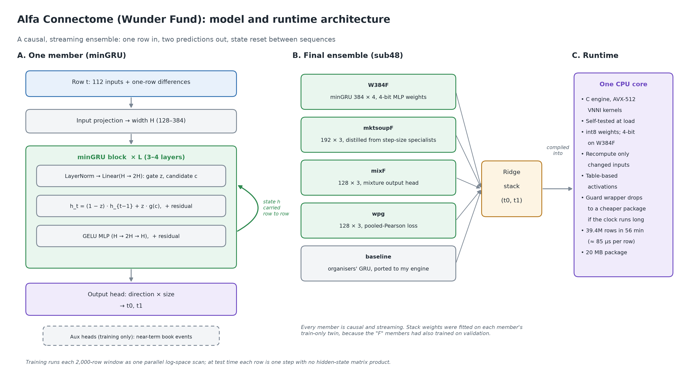
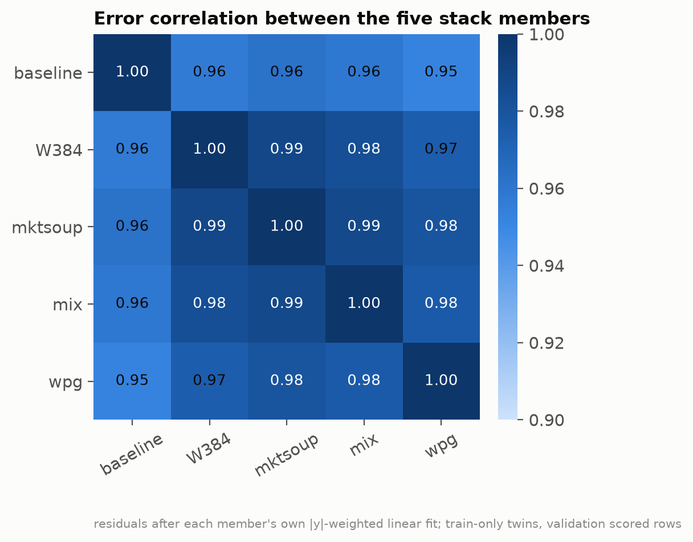
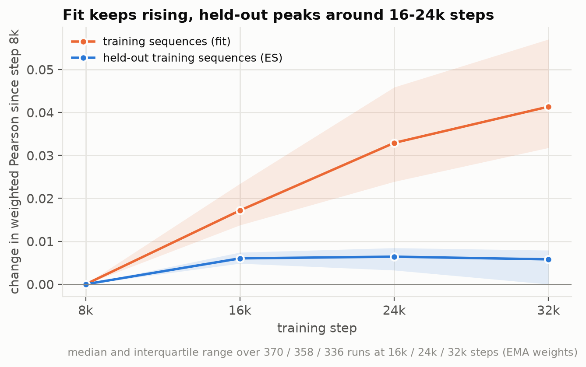
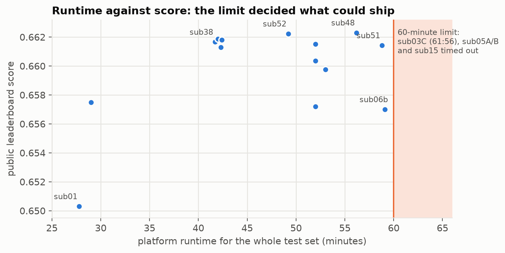

# Alfa Connectome (Wunder Fund): summary

**Final result: 94th of 5,841 teams on the private leaderboard (top 1.6%).** My best public score was 0.66230 (sub48), against 0.5935 for the organisers' baseline. My best public rank was about 160. I had drifted to about 202 by the time the public board closed, and the private leaderboard moved me up **108 places**. I worked on it from October 7 to November 10, 2026, with Claude (Anthropic's model, through Claude Code) as my engineering partner.

This is the middle-length version. [README.md](README.md) is the one-page version; [technical.md](technical.md) has everything, including every submission and every experiment.

## 1. The problem

- **Data:**
  - two anonymised order-book instruments, 112 quantile-transformed columns per row;
  - sequences of 20,000 consecutive rows: 10,607 for training (212M rows) and 1,873 for validation.
- **Task:** predict two targets, t0 and t1, that describe the first instrument's coming price move.
  - Rows arrive one at a time and state resets between sequences, so the model must be causal and streaming.
- **Metric:** a |target|-weighted Pearson correlation with predictions clipped at ±2, pooled over a hidden ~9% of rows.
- **The constraint that shaped everything:** inference had to run 39.4M rows on **one CPU core in 60 minutes** from a 20 MB zip. That's about 90 µs per row, Python overhead included.

## 2. Where the score came from

| Step | Public LB | Gain |
|---|---|---|
| Organisers' baseline | 0.5935 | |
| Baseline × 0.25 | 0.6503 | **+0.0568** |
| My single-model recipe (distilled, augmented minGRU) | 0.65749 | +0.0072 |
| Members also trained on validation | 0.65849 | +0.0010 |
| Ensembling different model types | 0.66230 | +0.0038 |

**83% of my total gain came from one observation on day one.** Claude's study of the baseline showed that many of its predictions sat beyond the metric's ±2 clip, and rescaling fixed it. It wasn't modelling. But it's the lesson I'd put first: read the metric before touching the model.

The remaining +0.012 is the modelling work. At that level, a gain of 0.0003 sits at the leaderboard's noise floor.

## 3. What the data turned out to be

- **Every target is a whole number of steps, and there are only four step sizes:** 0.125, 0.241, 0.469 and 0.657.
  - The coarsest group carries 48% of the score weight.
  - Every model scores about 0.44 there, against 0.73–0.80 elsewhere.
- **Claude decoded what the targets measure:** the extreme of the first instrument's **next price swing**. That's a stopping time, not a fixed horizon, and the rule reproduces the targets on 97–100% of cleanly decoded updates.
- **The missing information sits in the near future.** A "peek" model allowed to see the next 100 rows explains 0.86, against 0.69 for mine. Several independent checks found nothing available at prediction time that recovers that part.
- **Validation is a different period from train.** A classifier separates the two from the inputs alone (AUC 0.975), and the step-size mix differs.

Most of this explained the models' behaviour rather than improving them. But it decided which ideas got GPU time, and it closed dozens of dead ends cheaply.

## 4. The final model

A ridge stack of five streaming recurrent models:

| Member | What it is | Why it's there |
|---|---|---|
| W384F | minGRU, 384 wide × 4 layers, 4-bit MLP weights | Width was the one single-model lever that kept paying |
| mktsoupF | 192×3 minGRU distilled from a teacher of per-step-group specialists, soup of three fine-tunes | Capacity aimed at the four step sizes |
| mixF | 128×3 minGRU with a mixture output head | A different output form |
| wpg | 128×3 minGRU with a pooled-Pearson loss | Weak alone, different errors (negative weight) |
| baseline | The organisers' GRU, ported into my engine | By far the least-correlated errors |

**The recipe shared by the minGRU members:**
- the metric itself as the loss, through a direction/size output head;
- auxiliary targets for near-term book events;
- stateful training on 2,000-row windows with weight EMA;
- 70% distillation from an ensemble teacher, with volume and price augmentation;
- "F" versions retrained on train + validation.

The stack weights were fitted on each member's train-only twin, because an F member has seen validation.

My four members' errors correlate 0.97–0.99 with each other. The organisers' baseline, the weakest member (0.673 alone on validation), correlates 0.95–0.96, the most different. Dropping it cost 0.0015–0.0020 on my most reliable stack check.

## 5. Validation: the hardest part

Validation ran **0.023–0.031 above the public leaderboard**, and +0.003 gains on validation repeatedly showed up as zero on the board. Claude's analyses found why:
- most of the gap is the step-size mix;
- my edge over the baseline shrinks on data unlike train (+0.023 on the most train-like fifth to +0.010 on the least);
- leaderboard noise is about ±0.0003, and a full re-roll of a stack moves it by about 0.0008.

**The rules I set from that:**
- several yardsticks, never one;
- two seeds before any verdict;
- compare models trained on validation only with each other;
- a failure analysis before closing any idea;
- no training, weighting or selection toward the scoring mask, because the test's mask is hidden.

**The yardstick that finally worked was ESf,** a fold-honest stack scored on 200 training sequences no model trained on. It predicted sub48's gain over sub43 at +0.00042; the board measured +0.00050.

One disclosure: the no-mask rule covered training, weighting and selection, but not the stack itself. In every package the 12 ridge weights were fitted on validation's scored rows. Claude flagged this on November 8, and a mask-free refit was proposed but never shipped.

Across about 370 training runs, training fit keeps rising while the held-out score peaks at 16–24k steps. Regularisers and schedules delay the decline but never raise the peak. That's an information ceiling, not an architecture ceiling.

## 6. Inference engineering

Several of my best ensembles timed out at first, so runtime decided what could ship. Claude implemented each step below, and I gated each one on a bit-exact or metric-equal check:
1. ONNX Runtime at about 42 µs per row for one small GRU;
2. a Numba streaming GRU, 2.6–2.9x faster;
3. each row fused into one compiled call;
4. only changed inputs recomputed;
5. int8 weights;
6. table-based activations;
7. a C engine with AVX-512 VNNI kernels, self-tested at load;
8. 4-bit packed weights on the widest member.

That last step took the final line-up from a timeout to 42 minutes; with the baseline and wpg added back, sub48 ran in 56. A guard wrapper could switch to a cheaper package mid-run if the clock ran long. Every package was checked against the offline pipeline before I uploaded it.

## 7. What didn't work, and why

Claude's failure review sorted nearly every failed idea into a few mechanisms:

| Mechanism | Examples |
|---|---|
| The information is in the next 100–300 rows | Specialists for quiet stretches and the coarse group; big-move trackers; peek distillation; online adaptation |
| The model already has it | 356 classic signals and 41 order-flow features: real signal, but ±0.000 once stacked |
| It learns sequence identity | A LightGBM corrector: +0.001 in-sample, −0.0016 held out, and an early leaderboard miss |
| Seed noise larger than the effect | Most hyperparameter gains; mixture variants |
| Wrong yardstick | F members rejected on held-out train, which later gave a clear leaderboard gain |

**Other architectures hit the same ceiling as minGRU:** mLSTM, local attention, full GRU, twin per-instrument GRUs and convolutions.

**Pairs of runs differing in one setting** show the same pattern ([details](technical.md#8-a-closer-look-at-what-failed)). Only 2 of 129 changes lifted the coarse group (half the score) beyond seed noise, and neither is a real lead. The coarse group was also twice as noisy between seeds, so my two-seed gate could barely see it.

## 8. How the teams above me differed

After the competition I compared my solution with write-ups and posts from the 1st, 10th and 58th-place teams. We found the same step groups, target structure and ceiling. Where they did better:
- **Training labels:** huge teachers (16–33M-parameter LSTMs) distilled into small students, and short look-ahead teachers mixed into soft labels. First place was essentially that recipe.
- **Adapting to the validation period:** fine-tuning on validation after joint training, including on its scored rows. Both teams that fitted to the mask held up on private, so my no-mask rule probably cost me 0.001–0.002.
- **One well-sized student instead of an ensemble.** My own correlation matrix points the same way.

Where mine held up: the validation discipline and the inference engine. I gained 108 places from public to private, while the 58th-place team lost 9. My rules may have bought some robustness, though one shake-up can't separate that from luck.

## 9. Lessons

1. **Read the metric before the model.** One look at the clipping was 83% of my gain.
2. **The yardstick matters as much as the model.** My worst mistakes came from trusting one yardstick.
3. **Most data work explains rather than improves.** It's still worth doing: it decides where not to spend.
4. **Diversity beats copies.** Members that moved the board brought different errors.
5. **Inference is part of the model.** The engine is what let the best line-up run at all.
6. **Spend on labels and on one well-sized model.** That's where my remaining gap was.

## Roles

- **Claude:** wrote most of the code (trainer, analyses, C engine), ran the training queues and analyses on my desktop GPU, and kept the notes.
- **Me:**
  - the direction and the project's rules;
  - what to test next;
  - every upload and the final selection.
