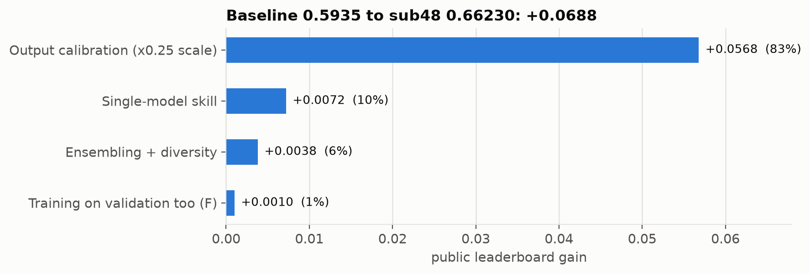
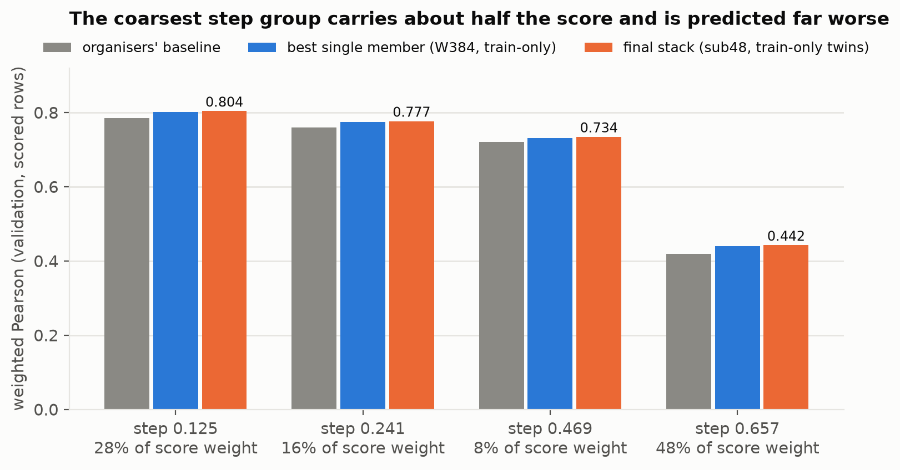
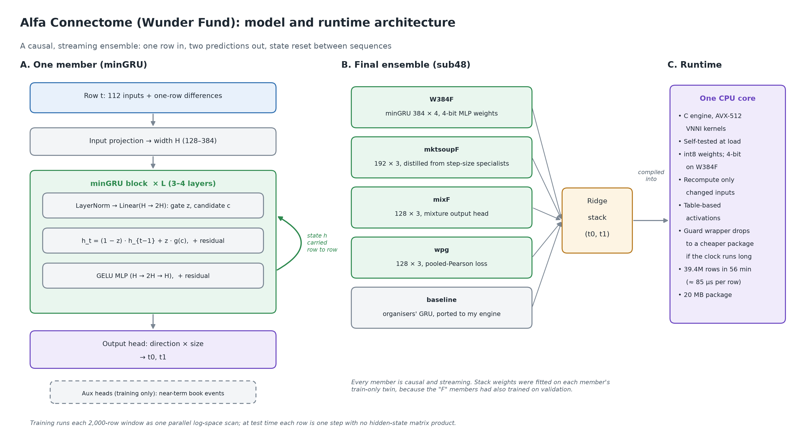
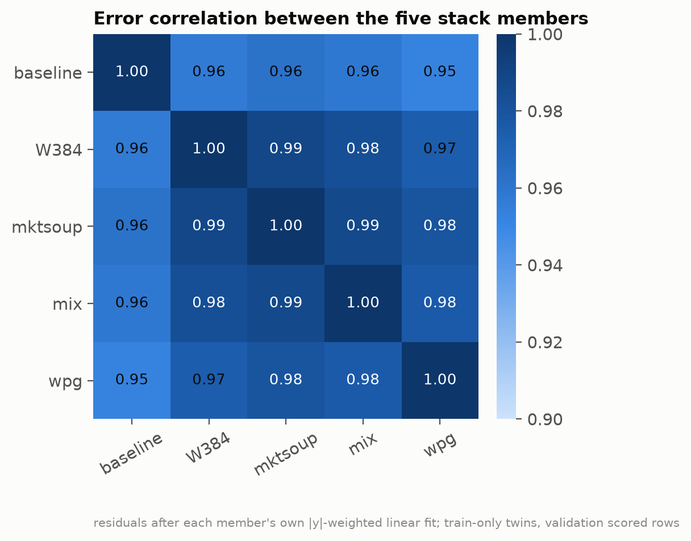
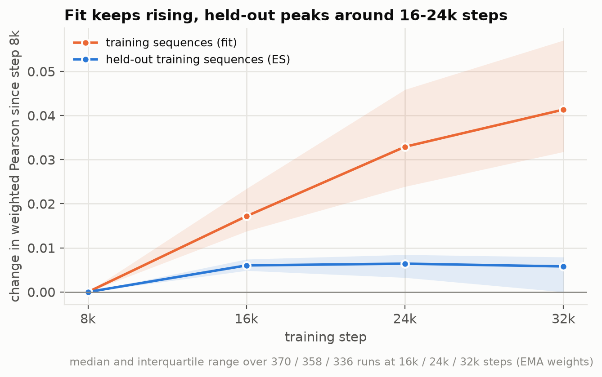
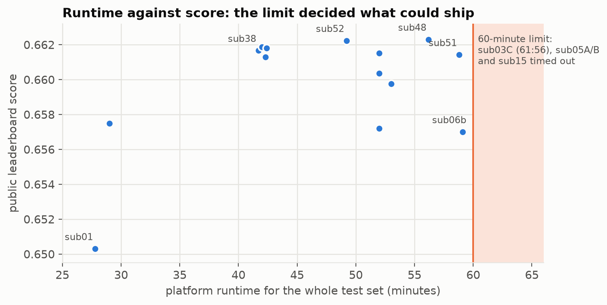
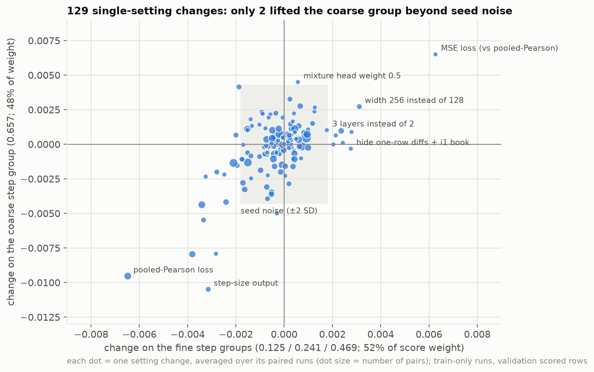

# Alfa Connectome (Wunder Fund): complete write-up

**Result: 94th of 5,841 on the private leaderboard (top 1.6%).** Best public score 0.66230 (sub48), against 0.5935 for the organisers' baseline. My best public rank was about 160; after I stopped submitting I drifted to about 202 as others passed me, and the private leaderboard moved me up **108 places**, from about 202 to 94th. I worked on the competition from October 7 to November 10, 2026.

**How I worked.** I ran the project with Claude (Anthropic's model, through Claude Code) as my engineering partner.
- **Claude's part:** writing most of the code (trainer, analyses, the C inference engine), running the GPU training queues and CPU analyses on my desktop, and keeping the notes (a day-by-day log, a results ledger, a failure review).
- **My part:** the direction, the rules of the project, what to test next, and every upload and final-selection decision.

Where an analysis below is Claude's, I say so.

[One-page version](README.md) · [Summary (3–4 pages)](summary.md)

This is the complete version: every finding, the model, validation, the engine, a quantified failure analysis, and appendices with every submission, a dated timeline and a catalogue of about 280 experiments.

---

## 1. The task

- **Inputs:** 112 anonymised float columns per row.
  - Two instruments, i0 and i1. Each has 22 price-like columns, 22 volume-like columns and 8 trade columns.
  - Eight extra columns, a0–a7.
  - Every column has been through a monotone (quantile) transform, so only the order of the values survives.
- **Sequences:** 20,000 consecutive rows each.
  - Train has 10,607 sequences (212M rows); validation has 1,873 with the scoring mask given.
  - Rows 0–98 are warm-up. Predictions are required on every later row, fed one row at a time, with state reset between sequences.
- **Targets:** t0 and t1, two indicators of i0's coming price move.
- **Metric:** weighted Pearson correlation (weights = |target|, targets and predictions clipped to ±2).
  - It's pooled over the scored rows of the whole test set (about 9% of rows; the mask is hidden for test), then averaged over the two targets.
- **Limits:** 1 vCPU, no GPU, 16 GB RAM, 60 minutes for ~39.4M rows, and a 20 MB zip. That's roughly 90 µs per row, including Python's per-row call.

## 2. Where the score came from

| Step | Public LB | Gain |
|---|---|---|
| Organisers' baseline, raw | 0.5935 | |
| Baseline × 0.25 (sub01) | 0.6503 | **+0.0568** |
| My single-model recipe (one distilled, augmented minGRU) | 0.65749 | +0.0072 |
| The same models also trained on validation ("F" members) | 0.65849 | ~+0.001 |
| Ensembling and member diversity (sub20, sub26, sub38, sub48) | 0.66230 | +0.0038 |

**The calibration step needs stating plainly, because it's 83% of the total.**
- On day one, Claude's study of the baseline found that a large share of its predictions sat beyond ±2, where the metric clips them.
- Any scale up to about 0.35 fixes it, and the curve is flat there.
- It wasn't clever modelling, but it's the lesson I'd put first: read the metric before touching the model.

**Everything after that** (the remaining +0.012) is the modelling work this write-up is about. At this stage, gains of 0.0003 sit at the leaderboard's noise floor.

## 3. What the data turned out to be

Most of the competition went into understanding the data. Most findings explained the models' behaviour rather than improving them, but they decided which ideas were worth GPU time.

### 3.1 The targets

- **Every target is a whole number of steps.** Each sequence has one step size shared by t0 and t1, and there are only four: 0.125, 0.241, 0.469 and 0.657.
  - The group can be recognised from the 99 warm-up rows 96% of the time, and by row 1,000 99.4% of the time.
  - Claude's tooling reads the step from the data rather than from hard-coded values; I made that a project rule.
- **Hard pair rules:**
  - t0 and t1 are never both positive.
  - When one is positive, the other is at most −3 steps.
  - (0, −1) and (−1, 0) make up 40% of scored rows.
- **A direction/size split.** Writing t0 = D − C and t1 = −D − C separates direction D from a shared, spread-like part C.
  - A perfect D alone would score 0.956; a perfect C alone 0.713.
  - **Direction is the bottleneck.** My models predict D and C through a dedicated output head.
- **The target definition.** On October 28, Claude decoded the target rule: t0 and t1 are measured against the extreme of i0's **next price swing**.
  - This is a stopping time, not a fixed horizon.
  - The rule reproduces the targets on 97–100% of cleanly decoded updates.
  - Median horizons (train / validation) run from ~17 rows on the finest step to 226 / 170 rows on the 0.469 step and 135 / 52 on the coarsest, and about 1,000 rows for big swings.
- **Targets change only on rows where i0's price block updates** (100% of changes), almost always by one step in one target.

### 3.2 Where the difficulty is

- **The coarsest step (0.657) carries 48% of the score weight**, and every model scores ~0.44 there against 0.73–0.80 elsewhere.
  - Against the rescaled baseline, my final stack gains +0.022 there and +0.013 to +0.018 in the other groups. The coarse group improved as much as any, but it still sits near 0.44.
  - In the coarse group the models get the side of a flip right (AUC 0.87). What they can't see coming is a **big move**, where one side goes to −3.
- **The missing information is in the near future.** A "peek" teacher allowed to see the next 100 rows explains 0.86 against my models' 0.69. Several independent checks agree that nothing available at prediction time recovers that part:
  - reconstructing past targets after the fact;
  - per-sequence offset oracles;
  - online adaptation with labels revealed later.

### 3.3 The inputs

- **The price columns aren't book levels.** Each 11-column block is a joint, quantile-transformed encoding of the book state:
  - all 22 price columns change on the same rows;
  - there's no top-of-book column;
  - bid < ask fails on every row.

  Sorting the book costs −0.04, so column identity matters.
- **Tick moves are decodable; levels weren't, for me.**
  - One linear map per step group decodes the tick moves 98.6–100% exactly on unseen sequences. On a step group it never saw, a single pooled linear decoder gets 71% on the finest group, and a nonlinear one that Claude built gets 95–97%.
  - But feeding decoded ticks instead of raw prices lost −0.0045. The within-row shape of the price block carries the direction information.
- **a0–a7 behave like clocks and activity measures,** tied to C and never to D.
- **Sequences are consecutive slices of longer streams.** The rules treat sequences as independent, so I used this only offline, to build validation splits that never put neighbouring slices on both sides.
- **Train and validation are different periods.**
  - A classifier separates them from the inputs alone at AUC 0.975.
  - Validation also has a different step mix.

### 3.4 The scoring mask

- Scored rows are picked mostly by target size: big |D| is about 3x as likely to be scored. They come in runs of about 4 rows.
- **I chose not to train, weight or select toward the mask,** because the test mask is hidden. Claude measured mask-weighted fine-tuning as a diagnostic: +0.0013 for a single model. I left it out under that rule. Section 10 comes back to whether that was right.
- **One exception I didn't catch until late:** in every package, the 12 ridge stack weights were fitted on validation's scored rows. Claude flagged this on November 8, and a mask-free refit (all rows) was proposed but never shipped. So the rule covered training, weighting and model selection, not the stack fit.

## 4. The final solution (sub48)

| Member | What it is | Why it's there |
|---|---|---|
| **W384F** | minGRU, 384 wide × 4 layers, trained on train + validation, 4-bit MLP weights | Width was the one single-model lever that kept paying |
| **mktsoupF** | 192×3 minGRU distilled from a "market teacher" (generalists plus per-step-group specialists), weight-averaged soup of three fine-tunes | Capacity aimed at the four step-size markets |
| **mixF** | 128×3 minGRU with a 5-situation mixture output head | A different output form |
| **wpg** | 128×3 minGRU trained with a pooled-moment Pearson loss | Weaker alone, but different errors |
| **baseline** | The organisers' ONNX GRU, ported into my engine | By far the least-correlated errors (figure below) |

**The shared minGRU recipe:**
- **Inputs:** raw columns plus sentinel flags. Hiding the one-row-difference inputs was worth +0.0017.
- **Loss:** the metric itself (weighted Pearson), with the D/C output head.
- **Auxiliary targets** (training only): which side of the book changes first, time to the next mid event, whether a trade comes soon, the mid change over the next 1/2/3/5 updates, and the target's own next moves.
- **Training:** stateful on 2,000-row windows, with an EMA of the weights. The checkpoint is chosen on 200 training sequences no model ever trains on (the "ES" set).
- **Distillation:** 70% from an ensemble teacher, with per-sequence volume/price augmentation and the partner instrument frozen on 5% of sequences. This gave my best small single model and halved its fragility to input shifts.
- **F versions:** the shipped members were retrained on train + validation with the same recipe.

**The stack:** a ridge combination per target. Because an F member has seen validation, the weights are fitted on each member's **train-only twin**.

| sub48 stack weights | baseline | W384F | mktsoupF | mixF | wpg | bias |
|---|---|---|---|---|---|---|
| t0 | +0.012 | +0.545 | +0.572 | +0.408 | −0.193 | −0.047 |
| t1 | +0.015 | +0.642 | +0.394 | +0.335 | −0.073 | −0.086 |

After each member is put on its own least-squares scale, my four members' errors correlate 0.97–0.99 with each other. The organisers' baseline correlates 0.95–0.96, the most different of the five. That's why the weakest member (0.673 alone on validation, against 0.687–0.689 for my best) kept its place. Dropping it cost 0.0015–0.0020 on the fold-honest held-out-train stack check (ESf). It also transferred to the leaderboard 0.005–0.008 better than my yardsticks predicted.

**Offline scores of my three final selections** (validation scored rows, stack weights applied to the train-only twins): sub52 0.6906, sub48 0.6905, sub43 0.6899. I picked them because they were my top three public scores (0.66223, 0.66230, 0.66180). The platform doesn't show per-submission private scores, so I don't know which of the three produced 94th.

## 5. Validation: deciding what to trust

This was the hardest part of the competition. Validation ran **0.023–0.031 above the public leaderboard**, and gains of +0.003 on validation repeatedly showed up as about zero on the board.

What Claude's analyses found:
1. **The step mix explains most of the gap.** Re-weighting validation toward train's step mix reproduced three leaderboard scores within ~0.002 with one parameter. The test appears to sit 60–70% of the way from validation's mix to train's.
2. **My edge over the baseline fades on data unlike train.** Ranking validation sequences by how train-like they are, the edge shrinks from +0.023 on the most train-like fifth to +0.010 on the least. Every strong recipe fades by about the same amount.
3. **Leaderboard noise is about ±0.0003,** and a full re-roll of a stack moves it by ~0.0008. Differences under ~0.001 aren't evidence.

The rules I set from that:
- **Several yardsticks, never one:**
  - full validation;
  - validation re-weighted toward train's step mix;
  - the 200 held-out train sequences;
  - the least train-like third;
  - a validation split by stream, so the halves don't share neighbouring slices.
  - In the final weeks Claude added **ESf**, a fold-honest stack scored on the held-out train sequences. ESf predicted sub48's gain over sub43 at +0.00042; the board measured +0.00050.
- **Two seeds before any verdict.** Seed spread for these recipes (~0.002) was larger than most effects.
- **Compare F members only with F members.** sub51 lost 0.0009 by putting a train-only model in an F slot.
- **Analyse every failure before closing it:** where it helped, where it hurt, and the mechanism.
- **No test gaming:** no mask weighting, and no yardsticks tuned to leaderboard quirks.

Across 364 training curves, fit on training sequences keeps rising while the held-out score peaks around 16–24k steps. Regularisers, schedules, SWA and checkpoint averaging delay the decline after the peak but never raise the peak. That curve is the clearest single picture of where I ended up: at an information ceiling for models of this kind, not an architecture ceiling.

## 6. Inference engineering

The 60-minute single-core limit decided what could ship. Several packages timed out:
- sub03C (61:56);
- the first 192-wide packages and sub15;
- sub41tF and sub41uF (the first W384 line-ups).

sub39b finished in 61:41 and was scored, but a run past 60 minutes doesn't count for the leaderboard. Several of my best offline ensembles never shipped at all.

**The engine, step by step** (Claude implemented each step; I gated each on a bit-exact or metric-equal check):
1. ONNX Runtime per row: ~42 µs/row for one 2×128 GRU.
2. A Numba streaming GRU: 2.6–2.9x faster.
3. Each row fused into one compiled call: −20%.
4. Only the inputs that changed get their projection recomputed: −10–12%.
5. int8 weights with float32 accumulation: −0.0003 accuracy, 4x less weight memory.
6. Interpolated tables for erf and sigmoid. GELU's erf had cost as much as all the matrix multiplies: 39 to 28.5 µs/row.
7. A C engine with AVX-512 VNNI / AVX-VNNI kernels, bit-exact against the reference and self-tested at load.
8. The last MLP matrix folded into the head.
9. 4-bit packed MLP weights (a Q4K kernel, −18% µs/row). That took the W384 line-up from a timeout (sub41uF, int8) to 42 minutes (sub46).

**Lessons from running on the platform:**
- **The platform isn't the desktop.** Dense members ran relatively much slower there, because weight memory per row outgrew a server core's cache. Claude's fitted model: platform minutes ≈ 5.8 + 1.29 × desktop µs/row (sd ~2 min). The same line-up shape has run 49:12, 56:12 and 58:47, so identical work varied by about ±5 minutes.
- **A guard package** switches to a cheaper package at a sequence boundary after 50–55 minutes (the trigger changed between versions). The first version loaded both packages up front and failed the platform's 60-second pre-run; a lazy-loading version fixed it.
- **Every package was verified before I uploaded it:** the metric matched the offline pipeline on check sequences, outputs were finite, it loaded from a fresh directory, and it was timed interleaved against a known package.

## 7. What didn't work

Claude's failure review sorted nearly every failed idea under six mechanisms:

| Mechanism | Examples |
|---|---|
| **The information is in the next ~100–300 rows, not in the inputs** | Specialists and fine-tunes for quiet stretches and the coarse group; big-move trackers; future-horizon aux targets; peek distillation; online adaptation with revealed labels |
| **The model already has it** | 356 classic signals (momentum, range, imbalance: real signal, but ±0.000 once stacked on the model); 41 order-flow features; per-zone and per-group calibration; residual correctors |
| **It learns sequence identity** | A LightGBM corrector: +0.001 in-sample, −0.0016 held out. It caused an early leaderboard shortfall |
| **Seed noise larger than the effect** | Single aux heads (all of them off together cost −0.0027); hyperparameter tuning gains; mixture-pair variants |
| **Capacity moved off predictable rows** | Hold-weighting, C-weighted losses, D-focused losses |
| **Wrong yardstick or too small a sample** | F members rejected on ES (they later gave a clear leaderboard gain); selection on the far third alone |

Section 8 quantifies this: every single-setting experiment scored by step group against the seed-noise floor.

**Other closed lines:**
- **Architectures:** mLSTM, local attention, full GRU, twin per-instrument GRUs, convolutions, averaged multi-heads. All hit the same ceiling as minGRU.
- **Width:** 512×3 was +0.0015 on one seed and −0.0014 on the other, and wider didn't fit my 8 GB GPU.
- **Robustness augmentations** (drift, volume normalisation, blanking a5–a7): each bought real immunity to its stress case at 0.0001–0.0035 clean cost, which the leaderboard never repaid.
- **Retraining everything on all data (sub53):** −0.0008 on the board, consistent with re-roll variance plus losing the checkpoint pick.
- **Generic ML, run as an agent swarm:** nonlinear stackers, GBDT on 448 features, EMA filter banks, loss reshaping, pruning and low-rank distillation. Nothing beat |Δ| ≈ 0.0002.

## 8. A closer look at what failed

Section 7 sorts failures by mechanism. Here I measure every controlled experiment the same way, to see *where* each change helped or hurt.

> **Correction (2026-11-22).** The first version of this analysis scored each run's saved outputs as they were. Many runs apply an output scale at evaluation time, and the metric clips at ±2, so those runs were penalised unevenly. That made three claims wrong:
> - averaged heads looked like −0.030;
> - extra capacity looked like it cost the coarse group;
> - auxiliary targets looked like a +0.005–0.014 gain.
>
> Every run is now scored at its own best output scale, as the trainer does. The numbers below are the corrected ones.

### Method

- **The runs:** 272 train-only training runs with saved validation predictions. Claude paired every two runs whose settings differ in **exactly one** setting, filling in the trainer's defaults for settings a run predates. That gives 442 pairs: 70 differ only in the random seed, and 129 distinct setting changes remain after excluding the cases below.
- **Scoring:** each pair is scored on all 1,873 validation sequences (scored rows), split by step group, plus the 200 held-out train sequences.
- **The noise yardstick:** the seed-only pairs show how much two runs of the *same* recipe differ.
- **Excluded:**
  - runs trained on validation (their validation scores are in-sample);
  - the peek teachers (they predict shifted targets);
  - the per-step-group specialists (they're scored on groups they never trained on).

### The noise floor was uneven

| Seed-to-seed SD of the difference | all | step 0.125 | 0.241 | 0.469 | **0.657 (coarse)** | held-out train |
|---|---|---|---|---|---|---|
| | 0.0008 | 0.0012 | 0.0009 | 0.0011 | **0.0021** | 0.0020 |

- **The coarse group carries 48% of the score and is about twice as noisy between seeds as the fine groups.**
- At two standard deviations:
  - a single run against a single run can't see a coarse-group effect under about ±0.004;
  - two seeds per arm can't see one under about ±0.003.
- A two-seed gate on the overall score was reasonable, but it was blind to most coarse-group effects. The group that mattered most was the one I could measure least precisely.

### The coarse group almost never moved

| Of 129 single-setting changes | count |
|---|---|
| Improved the fine groups beyond 2 seed-SDs | 8 |
| Hurt the fine groups beyond 2 seed-SDs | 14 |
| Improved the coarse group beyond 2 seed-SDs | **2** |
| Hurt the coarse group beyond 2 seed-SDs | 7 |

**Neither change that lifted the coarse group is a real lead:**
- **MSE loss** was measured against the pooled-Pearson loss, which is itself worse. Against the main Pearson recipe, |y|-weighted MSE was about −0.001.
- **Mixture-head weight 0.5** comes from a single pair.

So, measured against my main recipe, **no single setting change moved the coarse group beyond noise.** Fine and coarse effects correlate 0.63 across changes, so most changes moved both groups the same way. But on the coarse group only two changes ever cleared the noise upwards, and on both groups clear harms outnumbered clear gains.

### What the pairs say about specific ideas

| Change | Fine groups | Coarse group | Reading |
|---|---|---|---|
| More capacity: width 128 → 192 (11 pairs) / → 256 (2 pairs); 3 layers instead of 2 (1 pair) | +0.0009 / +0.0031; +0.0018 | +0.0005 / +0.0027; +0.0010 | Capacity helped both groups a little. That fits the W384 line being the one lever that kept paying, and it says nothing about memorisation |
| Auxiliary targets, one at a time (book side, price grid, mid move, next update, side, pairs) | −0.0005 to +0.0010 | −0.0007 to +0.0013 | Individually inside noise. Turning all of them off at once cost −0.0027, so they helped together |
| Swing and spread aux targets at weight 0.5 | −0.0034 / −0.0005 | −0.0044 / −0.0035 | Harmful, mostly on the coarse group |
| Averaged 4 output heads | −0.0005 | +0.0004 | Neutral, as the original Q35 run found |
| Pooled-Pearson loss (the "wpg" member) | −0.0065 | −0.0095 | Worse alone, yet it stayed in the final stack at a *negative* weight (−0.19 / −0.07) as an error-correcting term |
| Step-size output head | −0.0031 | −0.0105 | Giving the model the step explicitly hurt the group it was meant to help |
| Distillation teacher: peek-100 → T4 ensemble | +0.0024 | +0.0010 | The one teacher swap beyond noise on fine steps; other teacher swaps were inside noise |
| Hiding one-row differences and the i1 book | +0.0028 | −0.0003 | A real noise cut, on fine steps only |

### What this changes in the story

1. **My "information ceiling" was really a coarse-group ceiling.** On the fine groups, single changes kept moving the score until late. On the coarse group, half the score, nothing in my search space moved it beyond noise.
2. **My yardsticks were least sensitive exactly there.** Two runs of the same recipe differ by 0.0021 (SD) on the coarse group. Seeing a ±0.002 coarse effect at two standard deviations needs about 4–5 seeds per arm. I ran two.
3. **The things that worked for the teams above me aren't single-setting changes,** which is why they don't appear in this map:
   - better labels (huge teachers, and short look-ahead teachers mixed into soft labels);
   - fine-tuning on the validation period;
   - separate per-instrument streams (+0.0019 on their coarse group).

   My search was dense in settings and sparse in labels and training regime, the axes that moved the coarse group for others.
4. **What I'd do differently:** gate every idea on a coarse-group score with enough seeds, and spend GPU time on label quality (teacher size and look-ahead) rather than another round of auxiliary heads.

### Caveats

- Many changes have one or two pairs.
- A pair controls for one setting, but the base recipes differ across pairs, so an effect can depend on the recipe it was tested in.
- These are train-only runs scored on validation. The leaderboard rewarded transfer that validation scores don't fully capture: the baseline transferred 0.005–0.008 better than my yardsticks predicted.

## 9. How I worked

- **Hardware:** a laptop for analysis on a small cache; a desktop (Ryzen 5 9600X, RTX 5060 Ti 8 GB, 15 GB RAM) over Tailscale for GPU training, CPU jobs and package timing.
- **Training ran in queues** (numbered up to 98). Claude wrote each queue, scored and logged every run automatically, and kept the rule of one GPU training at a time, with CPU analyses under memory caps.
- **Records:**
  - a day-by-day log of every step's why and findings;
  - a results ledger of every finished test;
  - a ledger of gains that stuck;
  - a failure review by mechanism;
  - a model registry with a fixed naming scheme.

  Exact settings and scores for 505 training runs are kept, so any model can be retrained deterministically.
- **Agent swarms for broad questions.** I had Claude run parallel agent swarms for:
  - a data atlas (~47 graphs);
  - target-horizon decoding;
  - a bug hunt on the gap (none found; my metric matched the official scorer to 1e-10);
  - code, SIMD and cache work on the engine;
  - a data-shaping review;
  - a generic-ML review.

  Each swarm ended with a skeptic checking proposals against history and the noise floor.
- **Every leaderboard upload and the final selection were my calls.**

## 10. How the top teams differed

After the competition I compared my solution with write-ups and posts from teams above me: baselinemax (1st), musya (#10), and the team of ayushcoder894, jy447 and Japjotcpp (58th private, 0.66938 public).

**Where they matched my findings.** All of them found:
- the same four step groups, with the coarse one carrying about half the weight at ~0.44–0.45;
- the same target structure;
- that the coarse group is limited by information rather than model size;
- that real ensemble gains come from a model built a different way (their separate-pipeline GRU, my organisers' baseline).

They also closed many of the same dead ends: per-group rescaling, hand-built order-flow features, trees, online learning, output smoothing.

**Where they did better:**
1. **Training labels.**
   - Huge teachers (16M- and 33M-parameter LSTMs trained for hours on CPU) distilled into small students. baselinemax won first place with essentially this recipe: huge teachers, ensembled, distilled into one student sized to fit the time limit.
   - Look-ahead teachers that see the next 20–50 rows, mixed into soft labels with the true targets.
   - My peek tests agreed that 100+ rows hurts and that 30 rows alone ties. I stopped there; I didn't try mixing a short look-ahead teacher with a big causal teacher.
2. **Adapting to the validation period.** The 58th-place team trained on train + validation like my F members, then fine-tuned again on validation, per step group, with soft labels and same-parent weight soups. One of their pipelines gained +0.007 public from fine-tuning on validation's scored rows.
   - My plain recency fine-tune after joint training gained nothing.
   - The mask-weighted part is what I ruled out. Both mask-fitting teams held up on the private board (49th to 58th; musya unchanged), so my no-mask rule probably cost about 0.001–0.002. I don't have evidence it bought robustness in return.
3. **One scaled-up student instead of an ensemble.** baselinemax's point is that distilled students end up so correlated that sizing one student properly beats ensembling several. My correlation matrix says the same. I spent my runtime budget on five members where one bigger, better-taught student might have done more.
4. **Smaller architecture gains:** LSTM with projection, piecewise-linear input encoding, a learned per-sequence normalisation that starts switched off (my hard per-sequence normalisation lost 0.005), and separate streams per instrument (+0.0019 on the coarse group).

**Where mine held up:** the validation discipline (yardsticks and fold-honest stacks; their session folds and written expectations are the same idea) and the inference engine. From my final public rank (about 202) I gained 108 places on private, while the 58th-place team lost 9. One plausible reading is that my rules (no mask fitting, gains had to hold on data unlike train) bought some robustness. But one shake-up can't separate that from luck.

## 11. Lessons

1. **Read the metric before the model.** One look at the clipping was worth 83% of my total gain.
2. **The yardstick matters as much as the model.** My worst mistakes came from trusting one yardstick: shipping a validation-fitted corrector, and rejecting F members on held-out train. The yardstick that finally called leaderboard changes was the fold-honest stack.
3. **Most data work explains rather than improves.** Decoding the targets closed dozens of dead ends cheaply, but it didn't hand the models new information; they had already found it.
4. **Diversity beats copies.** Same-family members saturate at about three. The members that moved the board brought different errors.
5. **Inference is part of the model.** Several of my best ensembles never shipped. The engine work is what let the best line-up run at all.
6. **Spend on labels and on one well-sized model.** From the comparison with the top teams, that's where my remaining gap was, more than in architecture.
7. **Leave margin.** sub48 ran 56 of 60 minutes against a platform whose runtimes varied by minutes. A faster variant was designed but not built in time.

---

# Appendices: the full record

**Voice.** "I" is the competitor and "Claude" is the AI assistant.

**Abbreviations.**
- **FV:** full validation (1,873 sequences).
- **ES:** score on 200 held-out train sequences.
- **TL:** test-like re-weighting by step mix.
- **far / near:** stream half B, split by how unlike train the data is.
- **ESf:** fold-honest stack estimate on ES.
- **F member:** a member trained on train plus all validation.
- **us/row:** desktop microseconds per row.

## Appendix A: Submission table

Public LB is the public leaderboard score. Runtime is the platform wall-clock, where the 60-min limit applies. Rows marked "built" have a zip or a build log but no recorded upload or score.

| sub | date | what changed (≤12 words) | public LB | platform runtime | public rank |
|---|---|---|---|---|---|
| starter baseline | ≤10-09 | starter GRU, raw outputs | 0.5935 | 27:47 | — |
| sub01 | ≤10-09 | baseline GRU, outputs ×0.25 (stop ±2 clip) | 0.6503 | — | — |
| sub01 (re-probe) | ~10-20 | same zip resubmitted to test whether test changed | 0.65027 | — | — |
| sub02 | — | ens + corrector (built; folder only) | — | — | — |
| sub03A | — | ens4 + corrector (built; zip only) | — | — | — |
| sub03C | 10-10 | 4-model ens (auxmid-nod1, auxmid, aux05, win-z) + evt2 corrector | — | timeout 61:56 | — |
| sub03D | 10-10 | 3-model ens (auxmid-nod1, auxmid, win-z) + evt2 corrector | 0.6537 | — | 354 |
| sub03Dn | — | sub03D without corrector (built) | — | — | — |
| sub04 | — | nod1i1 + reg + win-z, no corrector (built, not uploaded) | — | est. ≈38 min | — |
| sub05A / sub05B | — | dense minGRU 192×3 "next" members + window model | — | timeout | — |
| sub05Aq | — | sub05A int8 (built) | — | — | — |
| sub06 | — | minGRU 128×2 next + window (built) | — | — | — |
| sub06b | ≤10-15 | minGRU 128×2 next, no-d1, + window | 0.6570 | 59:07 | — |
| sub07 / sub07b | ≤10-13 | minGRU 128×3 next + win-zaux; batched variant (timing builds) | — | — (41.1 / 42.8 us/row) | — |
| sub08a / sub08a_packed | ≤10-15 | mixture + win-zaux, int8 (timing) | — | est. ≈42 min (32.6 us) | — |
| sub08b / sub08b_packed | ≤10-15 | next + mix + win-zaux, int8; over budget, dropped | — | est. ≈63 min (48.3 us) | — |
| sub09 | 10-15 | mix-s0 + pres-s0, int8, packed, no window model | 0.6572 | est. ≈52 min / ~53.5 min | — |
| sub10 | 10-16 | pure linear EMA filter bank (LB probe) | 0.6026 | 17:57 | — |
| sub11 | 10-16 | distaugF + mixF, int8 (train + all validation) | 0.65976 | est. ~53 min | ~170 |
| sub12 | 10-17 | distaugF + mixF + presF, fast erf kernel | 0.66035 | passed (39.0 us) | ~159 |
| sub13 | 10-19/21 | hp8F replaces distaugF (hp8F + mixF + presF) | 0.66035 | 52.8 min (est.) | — |
| sub14a | 10-20/21 | single distaug control probe | 0.65749 | ~29 min | — |
| sub14b | 10-20/21 | probe: a0..a7 hidden | 0.65630 | ~29 min | — |
| sub14c | 10-20/21 | probe: a0..a7 shift/rescale augmentation | 0.65744 | ~29 min | — |
| sub15 | 10-25/26 | mkt192F + mixF, mixed-width kernel, int8 | — | timeout (>60 min) | — |
| sub16 | 10-26 | mktsoupF + mixF (F soup), built 37.4 us/row | — (expected = sub20) | — | — |
| sub17 | 10-25 | EVR-teacher student, gated; gate failed | — | — | — |
| sub18 | 10-26 | mkt192F trained with validation ×3 (recency) + mixF | 0.65982 | 49:52 | — |
| sub19 | 10-26 | mkt192F alone, Numba int8 | 0.65849 | 42 min | — |
| sub20 | 10-26 | mkt192F + mixF, SPEED2 + C kernel | 0.66021 | 50:42 | — |
| sub21 | 10-26 | mkt192F + baseline-gru | 0.65951 | 52:16 | — |
| sub22 / sub23 | 10-26 | planned (v2F; mktBF); queues stopped / gate failed | — | — | — |
| sub24 | 10-27 | mkt192F + mixF + baseline, C row engine | 0.66061 | 26:37 | — |
| sub25 | 10-27 | sub20's members on the C row engine | 0.66019 | 22:06 | — |
| sub26 | 10-27 | mktF + soupF + mixF + baseline, VECACT | 0.66108 | 29:12 | — |
| sub27 | 10-27 | "kitchen8": 8 members + baseline | 0.66099 | 50:12 | — |
| sub28 | 10-27 | 384F + mktF + mixF + baseline | 0.66074 | 54:32 | — |
| sub29 | 10-27 | mktBF; not built (MKTB gate failed) | — | — | — |
| sub30 | 10-28 | sub26 with mktF swapped for smix192F | 0.66103 | 28:57 | — |
| sub31 | 10-28 | sub26 + smixF as 5th member | 0.66116 | 37:17 | — |
| sub32 | 10-28 | sub26 + teacher-free tf192F | 0.66136 | 39:52 | 167 / 5537 |
| sub33 | 10-28 | sub26 + teacher-free GRU F (sees d1) | 0.66116 | 36:36 | — |
| sub34 | 10-28 | sub26 + tf192F + tfgruF (6 members) | 0.66136 | 43:52 | — |
| sub35 | 10-29 | sub32 + tf128F | 0.66135 | 46:57 | — |
| sub36 | 10-29 | sub32 with mktF swapped for tf192F-s1 | 0.66135 | 37:27 | — |
| sub37 | 10-29 | sub36 + MXT-s0 (mix-tilt) | 0.66116 | 41:52 | — |
| sub38 | 10-29 | sub36 + gru-mg128x3wpg-s1 (loss-diverse member) | 0.66166 | 41:42 | 160 |
| sub39a | 10-29 | sub38 − baseline + wmse + SWG + MH25 (built, not shipped) | — | est. ~51 min | — |
| sub39b | 10-29 | sub38 + wmse + SWG (8 members) | 0.66168 (did not count) | 61:41, over limit; "timed out" | — |
| sub40a / sub40b | 10-29 | sub39a / sub39b as F; too slow (34.6 / 37.7 us) | — | — | — |
| sub41t / sub41u | 10-31 | W384 + mktsoup + mix (± wpg), train-only twins | — | — | — |
| sub41tF | 10-31 | W384F + mktsoupF + mixF + wpg-s1, int8 | — | timeout | — |
| sub41uF | 10-31 | W384F + mktsoupF + mixF, int8 | — | timeout | — |
| sub42 | 10-31 | sub38 with baseline-gru swapped for DRIFT-s0 | 0.66144 | 43:52 | — |
| sub43 | 11-02 | sub38 with tf192F swapped for REG192F | 0.66180 | 42:21; rerun 46:27 | 163 |
| sub44 | 11-02 | sub38 with wpg swapped for wpgF-s1 | 0.66155 | 44:01 | — |
| sub45 | 11-02 | sub38 with int4 MLP weights | 0.66129 | 42:17 | — |
| sub46 | 11-02 | W384F + mktsoupF + mixF, int4 MLP, no baseline | 0.66186 | 42:02 | — |
| sub47 | 11-02 | sub46 + baseline (built) | — | — | — |
| sub48 | 11-02 | sub46 + baseline + wpg, int4 | **0.66230** | 56:12 | — |
| sub49 | 11-02 | sub48 with val+ES stack weights; not recommended | — | — | — |
| sub50 | 11-02 | sub48 + runtime guard (fallback sub26) | — | — | — |
| sub51 | 11-03 | sub48 with train-only W384D-s0 in W384F's slot | 0.66142 | 58:47 | — |
| sub52 | 11-03 | sub48 with distilled W384DF-s0 in W384F's slot | 0.66223 | 49:12 | — |
| sub52g | 11-03 | sub52 + eager 55-min guard | — | prerun timeout | — |
| sub52gL | 11-03 | sub52 + lazy-loading guard v2 | — | — (fixed the prerun timeout) | — |
| sub53 | 11-04 | sub48 with every member retrained on all data | 0.66151 | 52:01 | — |
| sub53gL | 11-04 | sub53 + lazy guard 55 | — | — | — |

**Final selection** (3 slots; the score is the best of the three on private).
- sub52: 0.66223, submitted 11-03 12:31
- sub48: 0.66230, submitted 11-02 19:02
- sub43: 0.66180, submitted 11-02 09:05

I picked them because they were my top 3 public scores. The record does not show which of the three gave the final place.

**Final result:** 94th of 5,841 on the private board (top 1.6%).
- Best public rank was about 160 (sub38).
- Public rank at close was about 202, so the move to private was up 108 places.

**Other leaderboard context:**
- Leader at 0.6717 on 10-10 (I7) and 0.6724 on 10-15.
- Competitor KennyOP: 0.694 dev, 0.665 LB, 20 min. Competitor Vadim_Sechin: ~0.684 / ~0.658.

## Appendix B: Timeline

| Date | Pivot | Why | Result |
|---|---|---|---|
| ≤10-09 | Scale outputs ×0.25 | metric clips at ±2 | +0.057 LB → 0.6503 (sub01) |
| ≤10-09 | B1 GRU recipe (2×128, metric loss, D/C head, stateful, EMA) | first trained model | FV 0.6772 (+0.0044) |
| 10-09 | Target autopsy with future-allowed models | I asked to stop guessing | dead-zone D is the main hole (dead books 33% of rows, 0.389) |
| 10-10 | First ensemble uploads, platform calibration | fit the 60-min limit | sub03D 0.6537 (rank 354); sub03C timeout 61:56; platform ≈1.3× desktop |
| 10-10 | evt2 corrector dropped | hurts held-out train (T1b) | −0.0016 |
| 10-11 | Target lies on a 4-step lattice | t0/t1 scatter clumps | coarse step u=0.657 scores 0.42 vs 0.73–0.79 |
| 10-11 | minGRU replaces GRU | 70% of step time in the GRU recurrence | 0.6849 single (+0.0033); mixture head 0.6869 |
| 10-15 | sub09 ties sub06b on LB → new selection rule | offline gains not reaching LB | must lead on every yardstick |
| 10-15/16 | Distillation + augmentation | robustness and teacher gain | distaug best single, FV 0.6875 / ES 0.4714 |
| 10-16 | MIXLB → TL yardstick; F members | LB gap from test step mix | sub11 0.65976, inside the predicted 0.658–0.661 |
| 10-20/21 | a-column drift probes (sub14a/b/c) | adversarial AUC 0.975 | hypothesis refuted on LB |
| 10-24 | Objective reset; stream-split halves + bootstrap CI | ~20 flat analyses in a row | protocol adopted |
| 10-24/25 | MARKETS specialists → market teacher → mkt192 student | treat data as several markets | mkt192 + mix +0.0018 all / +0.0031 unlike |
| 10-26 | sub15 timeout → ≤40 us/row rule; SPEED2 + C kernel | runtime estimate ignored the rule | 192+128 package 42.2 → 34.4 us/row |
| 10-26 | Unlike-train data becomes the gating yardstick | sub18 recency: val +0.0014, LB −0.0004 | train-like gains distrusted |
| 10-26/27 | C row engine (ROWC, VECACT) | more members within runtime | 25.9 → 14.2 → 9.0 us/row; sub24 0.66061 at 26:37 |
| 10-27 | Add diverse members | LB rewards added members | sub26 0.66108; sub27/28 lower → plateau ~0.661 |
| 10-28 | Teacher-free members | shared error likely from the teacher | sub32 0.66136, rank 167 |
| 10-28 | LB backtest of offline yardsticks | does offline agree with LB? | far Spearman +0.72, near +0.01; halfB_ens retired |
| 10-29 | far-based ship gate; 153-run member screen | sub37 lost and far called it | loss-diverse wpg member → sub38 0.66166, rank 160 |
| 10-31 | W384 passes both seeds; W384 lineups time out | width | +0.0028 / +0.0018 offline; sub41tF/uF timeout → hard ~31 us/row ceiling |
| 11-01/02 | PT16 + packed int4 kernel (Q4K) | runtime is memory traffic | −18% us/row; sub46 0.66186 at 42:02 (I submitted against Claude's advice) |
| 11-02 | ESf stack estimate; baseline back in | baseline error diversity, ESf +0.00042 | sub48 **0.66230** (actual +0.00050) |
| 11-03 | W384D distillation; F-slot rule | ESf +0.0035 | sub51 −0.0009; sub52 0.66223 (neutral); rule: compare F to F |
| 11-03 | Lazy-loading guard | sub52g prerun timeout (60 s limit) | sub52gL loads in 18–22 s |
| 11-04 | ALLDATA retrain; Swarms 3 and 4 | I asked for them | sub53 −0.0008; no input headroom; levers saturated |
| 11-09/10 | ANYSTEP and H1–H5 hypotheses | robustness to any step; I asked for the hypotheses | all rejected; last experiment |
| 11-21/22 | Final selection and close | — | sub52/sub48/sub43; 94th of 5,841 |

## Appendix C: Experiment catalogue

Verdicts:
- **kept:** shipped, or adopted as a rule or tool.
- **closed:** tested and rejected.
- **neutral:** no measurable effect, or a finding with no action.

### C1: Data / target findings
| ID | what | result |
|---|---|---|
| Error map | where error sits | ~40% = big wrong-sign moves in calm or dead-book stretches; neutral |
| Target autopsy | future-allowed vs past models | ~98% vs ~35% explained in dead/calm zones; big-move sign 98% vs 71%; kept (direction) |
| D vs C | oracle components | perfect D alone 0.956, perfect C alone 0.713; neutral |
| VOL | is \|D\| predictable? | 0.34 vs D 0.64; closed |
| Z2b | early dead-book call | AUC 0.87 at row 100; 55–70% of sequences switch; neutral |
| B0 / B0b | breakout direction | AUC 0.92, but D agrees only 55%; closed (aux downgraded) |
| DEC1 | quiet-zone D from next-update raw jumps | linear 0.94; finding |
| DEC2/3 | short + long parts of D | quiet 0.88, active 0.67–0.71; finding |
| MASK1 | what makes a row scored | big \|D\| scored 3× more often; kept as a do-not-game rule |
| DEC5–7 | shape, C content, volatility scaling | tanh-like, capped near ±0.8; C = book state + coming activity (0.64); D not vol-scaled; neutral |
| MID1 / ERR2 | accuracy decay; error concentration | 0.81 → 0.37 after 200 quiet rows; 10% of rows hold 73% of error; neutral |
| VOL2 / ACOL / TOB | volume states; a-columns; tick ladder | ~13k states per sequence vs ~12.8k; a-columns carry no D; 1-D ladder fails; neutral |
| JUMP1–3 | PCA of jump vectors | mode 2 corr 0.81, model already at 0.45; closed |
| SPLIT1 | natural axes of (t0, t1) | −45.9° / +44.1°; D/C split confirmed; kept |
| LAT1 | step lattice | four steps 0.125 / 0.241 / 0.469 / 0.657, identifiable at 99.5% within 1,000 rows; kept |
| LAT2/5 | weak class | u=0.657 holds 48% of score weight, model 0.42; finding |
| LAT6 | train vs valid step mix | fine-step share 12% (train) vs 21% (valid); finding |
| LAT7–10 | oracle and big-move analysis | true D lifts coarse 0.42 → 0.89; big moves 30% of rows / 65% of weight; closed |
| LAT11/12 | update timing; averaging | target changes only on i0 updates (100%); running mean −0.038, EMA −0.004; closed |
| TMOVE1–5 | what moves t0/t1 | foreseeable coarse 74–75% (AUC 0.86/0.90); book-move oracle reaches ceiling 0.875 vs 0.892; neutral |
| big_start | big-move start/end | AUC 0.94 / 0.97; fades to 0.87 at 20 rows; neutral |
| JOINT1 | t1 from true t0 | 0.956; joint calibration 0.6712 vs 0.6744; closed |
| FULLBOOK1/2 | forecast book | R² up to 0.72 / 0.83, no score gain; closed |
| BIG2–4 | coarse big-move loss | inside the move, not recoverable (0.400 vs 0.430); closed |
| SIZE1 | move size | book size corr 0.39–0.69, target step 0.05–0.11; neutral |
| MIRROR1–t4 | t0/t1 symmetry | symmetric (TV 0.027 < floor 0.035); mirror models 0.712–0.723 vs 0.725; closed |
| PATTERN1 | pattern dictionary | 0.6576 vs 0.6714; closed |
| BIG5–7 | latch rules | causal latch never beats model; closed |
| TRACK1 | tracker for big-move direction | 0.6402 → 0.6107; closed |
| RECON / POS / TSA | hindsight reconstruction; row position; time-series | coarse 0.270 → 0.614 in hindsight; horizon peak ~300 rows; neutral |
| SEQOFF | per-sequence offset | oracle +0.018, delayed 100 rows +0.001; closed |
| SHAPE | prediction-shape transforms | ×2 −0.0006 … tanh −0.011; closed |
| SPECTRAL / PERIOD | period-8/4 terms | 0.6914 → 0.6914; closed |
| DRIFT / A-MISSING | a-column reliance; missing flags | a0..a7 −0.080 (mine) vs −0.026 (baseline); adversarial AUC 0.975; flags are threshold rules; neutral |
| BASEDGE / EDGE FADE | edge over baseline vs train-likeness | +0.0228 → +0.0100 by fifth; valid +0.0147 vs test +0.0072; neutral |
| CHAIN/STREAMS / ESNEIGH | sequences are slices of streams | 5,537 / 1,149 streams; ES fair; neutral |
| STRUCT s2–s17 | 15 laptop structure analyses (roles, regimes, memory) | all flat (≤ +0.0004); closed |
| SCALEBOUND / SCALEPRED | per-sequence scale | oracle +0.0185, predictable corr ~0; closed |
| I1SWAP | swapped i1 as book | coarse 0.499 vs 0.073; no-go; closed |
| Data atlas | pipeline audit | 7 defects; in_norm 1.5–6× mis-scaled; old NRM/ALL verdicts invalid; kept (fixes) |
| Target definition | swing stopping-time rule | reproduces 97–100%; kept (understanding) |
| Output-structure oracles | snapping / forced loser | loser forced −0.0095, L-snap −0.031; closed |
| Error anatomy | where loss sits | g3 = 46% of weight, 57% of loss; wrong direction on big moves = 51% of loss; neutral |
| Quiet swing | reversal reflex | freezing state −0.284; resets 1.0% vs 3.8%; closed |
| Fifth step size | train sequence 4142 | not real (frozen g2 sequence); neutral |
| WHYTICKS | missing information | price SHAPE; neutral |
| S13d | reveal lag | 31/96/241/495 rows; 42.7% of rows never revealed; closed |

### C2: Input features
| ID | what | result |
|---|---|---|
| Noise cut (no-d1) | hide one-row change inputs | +0.0017 (0.6789); kept |
| Noise cuts stacked | auxmid + no-d1 + no-i1 | 0.6816 best single at the time; kept |
| no-deep | hide book levels 5–10 | −0.008; closed |
| reg inputs | regime rates, volume vs average | +0.0007 alone; pair 0.6835; kept |
| State embeddings (G1) | price blocks as categories | 0.6772; stack +0.0006; kept |
| V4 / V4b | resting-book lean | +0.041 on dead D, honest +0.0005; closed |
| Order-flow EXT | 41 flow features | mingru3flow 0.6840 vs ~0.6858; regflow 0.6782; closed |
| S0 / S0b | dead-feature scaling | +0.004 to +0.007 (noise); per-group unstable; closed |
| Event-time / PCA for W1 | window-model context | +0.0020 alone, ≈0 in ensemble; neutral |
| evc inputs on GRU | event-time context | 0.6742 (overfits); closed |
| A7 embedding | code embedding for a7 | FV 0.6870 vs 0.6871; closed |
| Q38–Q40 a-feature arms | augA, noA, noAflag | within ±0.0013; neutral |
| SIMPLE / SIMPLEFAR | 356 classic signals | stacked −0.0005..−0.0032; closed |
| s1 analog / s9 volume shift | nearest-neighbour; relative volume | +0.0001; −0.006; closed |
| Q43 FDROP | aug_hold 0.1 | −0.0027; closed |
| GAPFLAGS proj_fp32 | bf16 input rounding | s0 +0.0006 / s1 −0.0003; closed |
| NRM / ALL | in_norm + sentinel cleaning | trades train-like for unlike; later invalidated by atlas; closed |
| TCK | tick inputs | s0 −0.0009, s1 0.0000; closed (later flawed by aug_price) |
| NFX / C1 clean | fixed in_norm; cleaning | −0.0027; −0.0008; closed |
| EVG / PRI / I1S / RELV / DRB | event clock, priors, i1 swap, relative volume, drift + relvol | −0.0019 … −0.0004; closed |
| W1 hand features + EMAs | Discord claim test | 0.6709 vs baseline 0.6729; closed |
| RDRIFT | random-drift augmentation | s0 −0.0011, s1 far +0.0021; closed |
| VN | volume normalisation | −0.0006 / −0.0038; closed |
| Swarm 3 data shaping | residual hunt, columns, representation | ≤ +0.0001; closed |
| PLE / UVW | piecewise encodings | −0.0030 / −0.0006; closed |
| ANY / ANY2 | ticks with prices hidden | −0.0047 / −0.0045; ANYSTEP closed |
| H1 / H4 | level vs shape; probe | rejected |

### C3: Architectures
| ID | what | result |
|---|---|---|
| Window model W1 | memory-free hand features + z | +0.0015 → 0.6800; kept early |
| Event-stepped GRU (EV1/EV2) | step on mid events | 0.6580 / 0.6603; closed |
| minGRU | parallel-scan cell, 192×3 | 0.6849 (+0.0033); kept |
| Q7/Q12 minGRU sizes | 128×2 … 256×3 | 0.6840–0.6875 (mingru4next best, unshippable); neutral |
| Mixture head | 5-situation mixture output | 0.6869 vs 0.6852; kept |
| pres head | current-row head member | ES best 0.4731; kept (sub09, sub12) |
| Q15 step/lat ctx | step-aware inputs | 0.6833–0.6849; closed |
| Q21 mLSTM / local attention | new families | 0.6854 / 0.6856, same ceiling; closed |
| Q35 MULTIHEAD | 4 averaged heads | 0.6867 / 0.6875; closed |
| Q42 width vs count | 96-wide members | 5×96 −0.0014; count loses; closed |
| Q43 192-wide | wider member | ES +0.0034; kept |
| CHRONO / SLIM / slim-256 | init and MLP width | +0.0001; slim costs ~0.0007; −0.0018; closed |
| ROUTE192 | route specialists by step group | −0.0018; closed |
| Q53 BIG 384×4 | big distilled model | +0.0014 (gate +0.002 failed); 384 as member did not transfer (sub28); closed then |
| c10 SVDMLP | low-rank MLP | −0.0010 / −0.0044; closed |
| smix 192 | signed-candidate mix at 192 | −0.0009; closed |
| Teacher-free tf192 / tfGRU | no distillation | tf192 +0.00028 as 5th member; kept (sub32) |
| EVCLOCK | event-stream GRU | ES 0.4217 vs ~0.472; closed |
| FGRU / TWIN / G256 / W256 | full GRU, per-instrument, wide | −0.0001 … −0.0006, no replication; closed |
| W384 384×4 | width line | +0.0028 (CI [+0.0015, +0.0038]) / +0.0018; kept |
| FLN / HOLD192 / MLP1192 | final LayerNorm, hold, mlp 1 | −0.0008 … −0.0056; closed |
| baseclone | clone of baseline | +0.063 single, 0.0000 in stack; closed |
| W512×3 | wider | s0 +0.0015, s1 −0.0014; closed; bigger sizes out of memory |
| Swarm 4 families / cell swaps | new cells | \|d\| ≤ 0.00015; all tie minGRU; closed |

### C4: Losses and aux targets
| ID | what | result |
|---|---|---|
| Aux targets (H2) | side first, time to mid, trade soon | +0.0019 single; weight 0.5 → 0.6798; kept |
| aux 1.0 | weight 1.0 | 0.6790; closed |
| aux_mid | next-update mid targets | 0.6802 (+0.0004); kept |
| DEC4 aux_dec | decomposition aux | 0.6815, no gain on scored rows; closed |
| DC2 wpdc loss | D-focused loss | 0.6573; closed |
| aux_next / grid / side / surp | next-move aux | 0.6851–0.6860 (aux_next kept) |
| mixpair / mirror-tied | pair heads | 0.6852 / 0.6837; closed |
| Q16 C-weighted | C-weighted loss | 0.6826; closed |
| W4e humble shrink | output shrink | 0.6760 vs 0.6761; closed |
| Q30 aux targets | 4 new heads | −0.0018 / −0.0015; closed |
| Q33 WPG pooled Pearson | loss | −0.009 / −0.013 single; closed (later reused as a diversity member) |
| Q41 HOLDW | long-hold weighting | −0.0003 / −0.0018; closed |
| Q43 wMSE | loss-diversity member | −0.0012 single; later a screen pass (+0.0004) |
| MIXREAD | mixture readout | −0.0036; closed |
| SWG / SPR / QMV | swing, spread, quantile aux | −0.0028 … −0.0010; closed |
| AX0 / AX10 / AX25 / SWG10 / SPR10 | aux weight sweep | aux off −0.0027 (aux helps); others ≤ 0; closed |
| AUXGRAD | gradient cosine with validation | mix_head −0.22 at 128, −0.13 at 192; neutral |
| MH25 | mix_head 0.25 | far +0.0014 / +0.0009; kept (only arm to pass both seeds) |
| AU10 / AMO | aux 1.0; aux_mid off | mixed / −0.0016; closed |
| MXT mix_tilt | tilt | +0.0007 / +0.0002; LB −0.0002 (sub37); closed on LB |
| wpg member | Pearson-loss member | +0.0004 in screen; kept (sub38) |
| WP125 / WPOW / LTANH | loss shape variants | +0.0001; −0.0003; scored +0.0011 / all −0.0014; closed |

### C5: Distillation / teachers
| ID | what | result |
|---|---|---|
| T1 self-distillation | 3-checkpoint teacher | 0.6769; closed |
| Q22 4-architecture teacher | distil to minGRU | +0.0018 FV at alpha 0.3; kept |
| Q24 distaug | distillation + augmentation | FV 0.6875, ES 0.4714; best single; kept |
| Q32 PEEK | privileged near-future teachers | teacher 0.777 / 0.858, no transfer; closed |
| Market teacher → mkt192 | per-group ridge teacher | +0.0018 all / +0.0031 unlike with mix; kept |
| Teacher gap | in-sample optimism | 0.498 vs 0.475 (+0.023); neutral |
| Q47 OOF teacher | cross-fitted | −0.0002 / −0.0005; closed |
| Q49 MKT2 / Q51 EVR | stronger teachers | +0.0001; 0.6875 vs 0.6880; closed |
| c8 TEACHGAP / c4 VTEACH / MKTV | teacher memorisation and scale | newer members memorise ~2×; slopes 0.78–0.97; neutral |
| MKTB / CK16 | baseline in teacher; half-trained teacher | −0.0005 / −0.0006; closed |
| Distil-the-stack | — | dropped (distillation hurt on LB) |
| W384D | W384 on T4 targets | offline +0.0011 / +0.0013, ESf +0.0035; LB sub51 −0.0009, sub52 −0.00007; closed |

### C6: Calibration / correctors
| ID | what | result |
|---|---|---|
| ×0.25 output scale | stop ±2 clip | +0.057 LB; kept |
| LightGBM evt2 corrector | cross-fitted on validation | +0.0006–0.0010 in-sample; T1b −0.0016 on held-out train; withdrawn |
| In-sample scorer check | official scorer on sub03D | 0.6919 in-sample vs ≈0.6835 honest; neutral |
| CAL1 / LAT3 / LAT7 | per-zone, per-class, smoothing | −0.004..−0.008; +0.0005; −0.003; closed |
| Z1 zone confidence | per-zone scale | +0.0003; closed |
| CALIB / RECONFB | group multiplier; feedback | +0.0001; +0.0007; closed |
| HARDCOR | per-group correctors | coarse 0.4367 → 0.4167; closed |
| BLENDBASE | blend in baseline 0.1 | FV +0.0000, ES +0.0012; neutral |
| s6–s13 far / post-processing / per-sequence refit | 7 arms | ≤ +0.0004 or negative; closed |
| PEEK-300 rebuilder | label rebuild for adaptation | −0.0004..−0.0155; closed |
| MARKETS router + per-group calibration | specialists | +0.0019 [+0.0011, +0.0027]; ~half survives controls; kept (led to the market teacher) |
| c1 SCALECLIP / c2 CROSSSTACK | package scale; cross-stack | ±0.00004; +0.00003; closed |
| HEADFIT / trunk probe | trunk readouts | −0.0034..−0.0110; closed |
| CALIB / H5 | power calibration; residual probe | ≤ +0.00022; −0.0010..−0.067; closed |

### C7: Regularisation / training regime
| ID | what | result |
|---|---|---|
| Weight / layer dropout | in GRU | +0.0010; kept |
| Dead-zone specialists (W3g, Z3, Z5a–c) | specialise on dead books | 0.41 vs 0.44; 0.5988 vs 0.6044; closed |
| ADAPT | hold out a step group | unseen coarse −0.094; neutral (robustness finding) |
| Q19 per-sequence norm | — | 0.3611 vs 0.3609; closed |
| Q20 / Q26 / Q27 F training | add validation | presF ES −0.0059; HALFV +0.0013; distaugF ES +0.0018; kept |
| Q29 hp search | 8 combinations | hp8 FV 0.6883 / ES 0.4740 (+0.0026); kept |
| SWA / Q31 / Q36 | averaging, seeds | +0.0001–0.0007; neutral |
| Q37 DRO | worst-group training | NaN twice; closed |
| PBAL / Q44 VALIKE / W4f | re-weighting toward validation | FV −0.0012 / −0.0007; re-weighting 4/4 failures; closed |
| LONGWIN / chronolw / WIN5K | 5000-row windows | −0.0002 … −0.0022 far; closed |
| s12/s14/s15 state resets | periodic or event resets | −0.0016 … −0.0022, coin flip; closed |
| Q52 RECENCY | validation half A ×3 | val +0.0014, LB −0.0004 (sub18); closed |
| c7 CKPTFAR | checkpoint step | unlike-train peaks 16k; neutral |
| PERIODADV | DANN period adversary | adversary accuracy 0.11 → 0.24 in smoke test; queued, no recorded verdict |
| WRP / WARP / BIG | time warp | s0 +0.0008, s1 −0.0008; closed |
| WD03 / WD10 | weight decay | +0.0001; two-seed mean +0.0012; WD10 passes on average |
| CLIP5 / SCHED / FT | grad clip, schedule, fine-tune | +0.0008; +0.0011 mean; +0.0003 → +0.0007 both seeds; pass, small |
| DROPW / DROPR / BS64 | dropout variants, batch | −0.0002 / −0.0008 / −0.0013; closed |
| TAILC / WC3T | tail weighting | does not replicate; closed |
| DRIFT / DRIFTW384 / VJIT | drift and volume-jitter augmentation | −0.0001 (0.64 group −0.0049); far −0.0021; −0.0010; closed (sub42 −0.0002 on LB) |
| REG192 | regularised 192 member | +0.0008 / +0.0018; kept (sub43) |
| ckpt_select | last-EMA vs ES pick | last-EMA far −0.0014..−0.0032; kept ES pick |
| AMISS 0.3 / 0.1 | missing a5–a7 augmentation | fails clean (−0.0008..−0.0030); closed |
| MASK − FT | mask-weighted fine-tune | +0.0013 all; I ruled mask weighting out, so not shipped |
| ALLDATA | retrain all members on all data | sub53 −0.0008 on LB; closed |
| REG W384 / E24K | regularised W384; 24k steps | −0.0026; −0.00002; closed |
| Swarm 4 regularisers | 364 curves | delay the post-peak drop, never raise the peak; closed |

### C8: Ensembling / stacking
| ID | what | result |
|---|---|---|
| Second seed | B1 s1 | +0.0014; kept |
| select4 / select5 | greedy selection | 0.6830 / 0.6840; kept |
| Z1 / DC1 / Z2c | zone weights; D/C stacking | −0.0013 / −0.0055 / ≈0; closed |
| DIV1 | member error correlation | 0.94–0.995; neutral |
| Q18 all-in-one | every add-on in one model | 0.6866 / 0.6861 (= mixture); closed |
| mix + pres / mix + distaug | pairs | 0.6882 / 0.6883; kept |
| GROUPSTACK | per-group weights | 0.6890 vs 0.6891; closed |
| ENSFAR | greedy over 98 models | best ~+0.0007; neutral |
| SEEDPICK | pick the best seed | same sign only 39%; averaging +0.0010; picking closed |
| SOUP | weight-averaged fine-tunes | early soup5 −0.0059; F soup +0.0004, gate passed; kept (sub26 +0.00047 LB) |
| PARTNERS | partners for mkt192 | −0.0001..−0.0013; mix stays |
| Baseline as member | baseline-gru in stack | LB +0.0010 vs val +0.0002 (sub21); kept |
| c9 BASESHARE | baseline weight | 0.10 +0.00016; 0.30 −0.00075; neutral |
| ENSGREEDY | member order | 0.69235 → 0.69398, saturating; neutral |
| Kitchen sink (sub27) / 384 member (sub28) | more members | −0.0001 / −0.0003 LB; closed |
| div_scan | 160 runs as additions | corr 0.976–0.988, best +0.0004; neutral |
| Member screen | 153 runs on sub36 | wpg / wmse pass (+0.0003–0.0004); kept |
| Combos on sub38 | swaps / additions | +0.0000..+0.0002; additions saturated; closed |
| W384 combos | W384 in sub38 lineups | +0.0008 to +0.0010; kept (sub46/48) |
| stress_ens drift swap | hedge member | no hedge passes; closed |
| STACKFIT V1–V4 | stack weighting | none pass; V0 kept |
| ESf estimate | fold-honest stack | called sub48 +0.00042 vs actual +0.00050; kept (blind to F gain) |
| Swarm 4 stackers / seed soups | — | ≤ +0.0001; soup3 +0.0004; neutral |
| Swarm 4 kept items | int4 W384 gate; seed re-roll; second W384F seed | +0.0004; rms 0.00106; ES +0.0014; kept |
| H3 | further additions | ≤ 0.0000; rejected |
| Final offline re-score | four lineups | sub52 0.6906, sub48 0.6905, sub43 0.6899, sub38 0.6897; baseline error corr ~0.70 as first computed on raw outputs; 0.95–0.96 once each member is scaled (section 4) |

### C9: Validation methodology
| ID | what | result |
|---|---|---|
| FV rule | LB ≈ FV − 0.023 | gap later grew 0.022 → 0.029 → 0.031; replaced |
| ES hold-out | 200 train sequences | second yardstick; kept |
| LBNOISE | resampling | tie appears in 12% of 100-sequence samples; kept (selection rule) |
| LB transfer | model changes vs LB | about 1/3 of the gain carries, ±0.002; neutral |
| MIXLB → TL | step-mix re-weighting | explains LB within ~0.002; kept |
| LBYARD | 10 packages vs LB | all yardsticks ±0.002; neutral |
| Stream-split + bootstrap CI | judging protocol | kept |
| Unlike-train yardstick | after sub18 | kept |
| LB backtest | 12 → 18 packages | far Spearman +0.72 → 86% agreement; halfB_ens −0.20 retired; kept |
| Ship gate | far / TL far ≥ current best | kept |
| LB slices | 137 pairs | rows 2–6k +0.90 / 89%; chance +0.63; neutral |
| Two-seed gate | minimum detectable effect | ~0.0011 all / 0.0014 far; kept |
| F-to-F rule | after sub51 | kept |
| Validation vs train sign flip | gains | corr −0.13..−0.44; neutral |
| Re-roll spread | LB | ~0.0008; neutral |

### C10: Robustness
| ID | what | result |
|---|---|---|
| ROBUST | pres vs mix on ES | mix-s0 FV lead was luck; neutral |
| ROBUST2 | i1 hold / volume ×0.75 | −0.0299 / −0.0052; neutral |
| Q23 augmentation | i1 fragility | −0.0153; ES cost; kept via distaug |
| Filter bank / BANKSEARCH | linear EMA bank | capped ~0.62–0.63; LB probe sub10 0.6026; closed |
| Gap-swarm red team | alignment, metric, masks | no bug (scorer matched to 1e-10); neutral |
| Stress test | drift / jitter | clean edge +0.0123..+0.0159; drift ×3 −0.017..−0.026; volume change size breaks models; neutral |
| MISS stress | a5–a7 missing | members lean 3–4× harder than baseline; edge −0.003..−0.10; neutral |

### C11: Inference / runtime
| ID | what | result |
|---|---|---|
| SUB3 fused row call | one compiled call per row | ~20% faster; kept |
| Streaming reg / incremental input | exact to 1e-9 | 20% faster; kept |
| int8 weights | quantisation | −0.0003; kept |
| SPEED1 erf-GELU | fast kernel | 39.1 → 28.5 us/row; kept |
| Multi-core | 2 Numba threads | 45.6 → 34.1, but the platform has 1 vCPU; closed |
| KERNBENCH | integer matvec | int 1.7× slower; closed |
| SPEED2 / CKERN | dict removal; gcc C kernel at load | 42.2 → 34.4 us/row; kept |
| ACT8 / VNNI / HEADFOLD | uint8 activations; AVX-VNNI; fold | 36.4 → 32.6; 6.97 → 3.97 us per 192 member; ~1 us; kept |
| SPEED3 / ROWC | whole row in a C extension | 34.0 → 25.9 → 14.2 us/row; kept |
| gcc-12 self-test bug | slow path 58 us/row | fixed (allclose) |
| VECQ + VECACT | vectorised quant / activations | 14.2 → 9.0 us/row; kept |
| INT4COST / INT4 MLP | int4 weights | −0.0027..−0.0009 (192×3); MLP −0.00034; closed then |
| PT16 | — | 29.9 → 28.3 us/row, −0.00001; kept |
| Q4 / Q4K | int4 without / with packed kernel | stopped; −18% us/row; kept |
| Guard v1 / v2 | runtime fallback to sub26 | eager ~44 s load → prerun timeout; lazy 18–22 s; kept |

**Platform runtime models:**
- 12 + 1.04 × us.
- 12 + 0.9 × us.
- 12 + 0.91 × us.
- 12 + 1.125 × us for two members.
- C engine: 12 + 0.74..0.89 × us.
- 5.8 + 1.29 × us, sd 2.1.
- The same package varies by ±2–4 min or ±5 min.

### C12: Process incidents
| what |
|---|
| Queue 14 ran on CPU ~2 h (CUDA_VISIBLE_DEVICES empty) |
| RAM exhausted beside IsaacLab; kernel killed IsaacLab and the session |
| Wi-Fi watchdog reboot 10-17 19:32; hp7 killed at step 22,660 / 64,000 |
| CPU queue OOM 10-21 22:30 killed my 4.2 GB job and the Claude app |
| STRUCT queue failed (systemd OOMScoreAdjust) |
| Laptop 90 GB partial cache removed |
| Market-teacher indexing bug caught before use |
| sub15 built ~5 h late |
| sub15 timeout: Claude ignored the ≤40 us/row rule |
| sub28 runtime miss (predicted 40–45, took 54.5 min) |
| Contaminated ensemble file / mis-scaled equal-weight ensemble |
| Reboot 10-29 ~09:34 killed queue 65 |
| 10-29 22:18 OOM killed my app and a twin run |
| sub41tF/uF timeouts: Claude scaled off sub28 and broke the ~31 us ceiling |
| Baseline ES predictions at 0.25× scale invalidated V1 and the first sub49 |
| sub52g prerun timeout |
| Group-gating bug gave a spurious −0.007 |

## Appendix D: Compute and scale facts

| fact | value |
|---|---|
| Training runs with manifests | 482, then 505 after adding 23 |
| Prediction files / models with ES scores | 356 / 244 |
| Large single scans | ENSFAR 98 models; div_scan 160 runs; member screen 153 runs, then 155 candidates |
| Queues | numbered GPU queues from Q7 to ~Q98; one CPU queue (CPU1/CPU26) |
| GPU | RTX 5060 Ti, 8 GB (W512×4 / W768×2 / W384×6 ran out of memory) |
| Desktop CPU / RAM | Ryzen 5 9600X, 6 threads; 14 GB RAM; L3 32 MB; AVX-VNNI; gcc 13 |
| Platform | 1 vCPU; 60-min limit; 60-s prerun limit; gcc 12; likely no AVX-512 VNNI |
| GPU step times | GRU 27.1 ms/step (bs32 × 2000 window); minGRU ~11 steps/s; mLSTM ~5 steps/s |
| Run lengths | 32k steps standard; 40k; 48k–64k; ES peaks at 16–24k |
| Wall-clock per run | GPU ~1 h; 128 run ~46 min; F run ~45 min; mLSTM ~1 h 45; 384F ~3 GPU-h; 384×4 ~4–5 h; CPU ~19 h per 32k run |
| Batch searches | Q29 8 runs ~11 GPU-h; queue 65 ~9 GPU-h; queue 70 ~12–14 h; BANKSEARCH 24 configs ~3 h on CPU |
| Cache and storage | ~/wunder/cache 233 GB (deleted); dataset 33 GB; runs/preds 100 GB; preds_es 7 GB; weights 4 GB; laptop partial cache 90 GB |
| Laptop analysis cache | cache_lite = 1,873 valid + 1,000 train sequences |
| Train set | 10,607 sequences = 5,537 streams; also 10.4k and 10,601 |
| Validation set | 1,873 sequences = 1,149 streams; halves 940 / 933 |
| Validation rows | 3.5M rows; 1.77M scored rows; 6.5M state changes |
| Scored share | 9.5% of rows; 8.6% of validation rows |
| F vs ALLDATA training size | 12,280 vs 12,480 sequences |
| ES hold-out | 200 train sequences (1.9% of train) |
| Inputs | 229 input columns, 125 change per row |
| Agent swarms | research agent; 2 research agents; 4 failure reviews; SWARM 5; SWARM 2, 6; CODE SWARM 4; GAP SWARM 5; BIGSWARM 4; diversity 2; DATA ATLAS 5; quiet-swing; Swarm 1101, 6; Swarm 1102, 5; Swarm 3, 8 agents ~40 min; Swarm 4, 9 agents ~48 min |
| Memory guards for jobs | 3 GB systemd caps, start only at ≥6 GB free; swarm agents 1 thread, <1.5 GB |

### Conflicting values (both kept)
- **sub39b:** 0.66168 at 61:41, over the limit, vs "timed out".
- **sub09 runtime estimate:** ≈52 min vs ~53.5 min.
- **sub20 desktop speed:** 34.4 clean vs 38.0 under load.
- **sub15 desktop speed:** 46.5 us/row vs 45.0–45.7 → 41.6–41.8 after SPEED2.
- **Train set size:** 10.4k, 10,601, 10,607.
- **Volume states per sequence:** ~13k vs ~12.8k.
- **Scored share:** 9.5% vs 8.6%.
- **minGRU seed spread:** ~0.002 vs ~0.0003.
- **Steps per run:** 32k, 40k, 48k–64k.

**Numbers I couldn't pin down:**
- LB scores and upload status for sub02, sub03A, sub03Dn, sub05Aq, sub06, sub07, sub08a/b and sub16.
- Platform runtimes for sub11, sub12 and sub13.
- LB scores for sub52gL and sub53gL.
- Public ranks for all but sub03D, sub11, sub12, sub32, sub38 and sub43.
- Total GPU-hours.
- Exact queue count.
- Total agents across all swarms.
- Size of the train set in rows.

## Appendix E: methods and records

- **Metric:** my implementation matches the official scorer to 1e-10.
- **Per-model scores:** every saved prediction file is scored at its own best output scale, as the trainer does, because many runs save raw head outputs and the metric clips at ±2. Scoring raw outputs had biased an earlier version of section 8 and the baseline's error correlation.
- **Score definitions:**
  - "Validation" is all 1,873 sequences on scored rows.
  - Members marked F were trained on validation, so their validation scores are in-sample. Offline stack scores use the train-only twins.
  - Leaderboard scores are the platform's public scores as I recorded them.
- **Figures:** a figure script in my project repo builds every figure from the saved results:
  - per-model score tables for 356 models;
  - scored-row predictions for the final line-ups;
  - training logs for about 370 runs;
  - the leaderboard and runtime numbers from my notes.

  The pipeline and architecture diagrams (figures 8–9) are drawn from the design, not from data.
- **What's public:** this repo holds the write-ups and my three final submission packages (inference code and my members' weights, with the organisers' baseline removed, in [submissions/](submissions/)). The training code, run settings and logs stay private, and the competition data isn't mine to redistribute.
- **Credits:** comparison material from the public write-up by ayushcoder894, jy447 and Japjotcpp, and from posts by musya, baselinemax and Aidan on the competition Discord.
